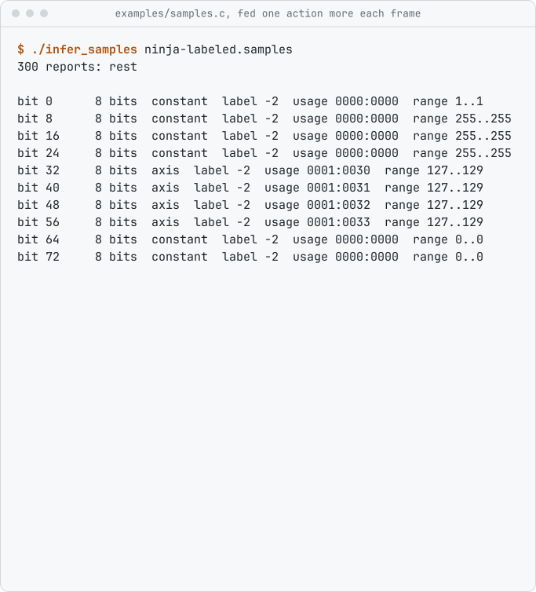

# report-guess

Give it reports from a device nobody documented, each one tagged with what you were doing when
it arrived, and it works out where the buttons, sticks and hats are. Then it writes a HID report
descriptor for that layout. Plain C, one header, no dependencies.

<picture>
  <source media="(prefers-color-scheme: dark)" srcset="docs/images/converge-dark.gif">
  
</picture>

Each frame above is [`examples/samples.c`](examples/samples.c) run on one more action of the
`tests/data/ninja-labeled.samples` session: 300 reports at rest first, then 20 actions. Bits
that never moved start as constants and turn into buttons and axes once an action moves them.

## What does it guess?

- **noise**: bits and fields that change while nobody touches the device
- **buttons**: single bits, active-high or active-low
- **axes**: width, sign, byte order, observed range, rest value and its spread
- **hats**: 4-bit direction fields with a null state
- **counters**, fixed step or timestamp-like, and **checksums**: sum8, xor8, crc8, crc8 Maxim,
  and crc32 with an optional seed byte
- **constants**: whatever never changes

Every field gets the label of the action that moves it most, and a HID usage to go with it:
buttons on the Button page, axes on Generic Desktop X to Wheel, hats as Hat Switch.
`infr_set_usage` overrides the usage per label. Counters, checksums, noise and constants
become padding in the descriptor.

Devices that prefix each report with a report ID are handled in one session created with
`INFR_REPORT_IDS`: every ID gets its own length and its own layout, and the descriptor gets one
input report per ID.

## How sure is it?

As sure as the session lets it be. A field is found only if some labeled action moved it, and an
axis range is only as wide as you pushed the stick. The test sessions in `tests/data` are
checked against layouts known from elsewhere:

- `ninja-*`: Gamer Ninja Sword (Home+X mode) reports built from its known mapping, labeled and
  free play
- `multi`: two input reports with different IDs and lengths
- `ds4-*`, `ds5-*`: the hid-tools DualShock 4 and DualSense simulators over USB and Bluetooth,
  with the DualShock 4 counter and timestamp filled in as the hardware does

`tests/gen` rebuilds them (`sony.py` needs hid-tools). `check.py` compares an analysis with the
layout taken from the real descriptor, and `decode.py` parses the emitted descriptor with
hid-tools and checks it against the fields. When
[hid-parser](https://github.com/augustoflorentino/hid-parser) 3.0 or later is installed, `ctest`
also parses every emitted descriptor in strict mode and decodes every sample through it,
comparing each value with the raw report.

## How do I use it?

[`examples/basic.c`](examples/basic.c) makes up a 3-byte report with one button and one axis
and goes through the whole cycle:

```c
infr_create(sizeof(report), 120, NULL, &s);
for (n = 0; n < 120; n++) {
    make_report(n, report);
    infr_add(s, n < 20 || n >= 100 ? INFR_REST : n < 60 ? 1 : 2, report, sizeof(report));
}
infr_analyze(s, &m);
infr_destroy(s);
infr_set_usage(m, 1, 0x09, 1);
infr_descriptor(m, desc, sizeof(desc), &len);
```

Labels: `INFR_REST` (0) for reports taken with the device untouched, `INFR_FREE` (-1) for free
use, and a positive number per action. `infr_analyze` turns the session into a model that does
not depend on it, so the session and its sample buffers can go as soon as the model exists.

The model is what you keep at run time:

- `infr_field_count` and `infr_field` list the fields, in report ID order
- `infr_normalize` inverts active-low buttons and swaps big-endian fields, so a raw report
  matches the descriptor
- `infr_read` gives one field of a raw report with sign, byte order and active-low applied,
  without a descriptor
- `infr_model_report_count` and `infr_model_report_info` list the reports it describes;
  `infr_report_count` and `infr_report_info` do the same for a session still collecting

`examples/samples.c` builds as `infer_samples` with `-DREPORT_GUESS_BUILD_EXAMPLES=ON`. It reads
a file with one report per line (label, then the report in hex; `#` starts a comment) and prints
the layout and the descriptor. Add `ids` after the file name for reports that start with a
report ID.

`infr_field_t` has a fixed layout for the whole 4.x series:

| member | meaning |
|---|---|
| `report_id` | report the field belongs to; 0 without `INFR_REPORT_IDS` |
| `bit_offset`, `bit_size` | position in the report; bit 0 is the low bit of byte 0, the ID byte when there is one |
| `kind` | `INFR_CONSTANT`, `INFR_BUTTON`, `INFR_AXIS`, `INFR_HAT`, `INFR_COUNTER`, `INFR_CHECKSUM`, `INFR_NOISE` |
| `flags` | `INFR_SIGNED`, `INFR_BIG_ENDIAN`, `INFR_ACTIVE_LOW` |
| `logical_min`, `logical_max` | observed range as `int64_t`; for hats the direction range, for counters the wrap value |
| `rest`, `noise` | value at rest and its spread while untouched |
| `label` | the action that moves the field, or `INFR_NO_LABEL` |
| `usage_page`, `usage` | HID usage written to the descriptor |
| `algorithm`, `covered_len`, `seed` | checksums: `INFR_SUM8` to `INFR_CRC32`, bytes covered from the start, crc32 seed byte or -1 |
| `step` | counters: increment per report |

Every call that can fail returns `INFR_OK` or an error code that `infr_strerror` describes.
`infr_destroy` and `infr_model_destroy` accept `NULL`, and nothing the library returns is yours
to free. Memory comes from `infr_create` and `infr_analyze` only (plus the first report of each
ID in `INFR_REPORT_IDS` sessions), through your allocator if you pass an `infr_options_t`.

## How do I build it?

```sh
cmake -S . -B build -DBUILD_SHARED_LIBS=ON
cmake --build build
cmake --install build --prefix /usr/local
```

```cmake
find_package(report-guess REQUIRED)
target_link_libraries(app PRIVATE report-guess::report-guess)
```

Without CMake: `pkg-config --cflags --libs report-guess`, or run `scripts/amalgamate.sh` and
copy `dist/report-guess/report-guess.h` into your tree. In exactly one `.c` file, define
`INFR_IMPLEMENTATION` before including it, and `INFR_STATIC` too if the functions should stay
private to that file.

`cmake --preset dev && cmake --build build/dev && ctest --preset dev` runs the tests with ASan,
UBSan and `-Werror`; `cmake --preset fuzz` builds the report fuzzer. Releases follow Semantic
Versioning: incompatible ones bump the major version and the soname, and the
[CHANGELOG](CHANGELOG.md) says what each update asks of existing code.

## Where does it go wrong?

- an action that moves two fields at once labels both with the same action; record one control
  at a time
- a stick pushed only halfway gives half a range
- at most 64 distinct action labels per session (`INFR_ERR_FULL` past that) and 16 report IDs;
  report ID 0 is rejected
- one checksum per report, and it has to be the last bytes it covers
- hats use values 0 to 7 plus a rest value of 8 or 15
- fields up to 32 bits, signed or unsigned at any width
- at most `INFR_MAX_HINTS` usages set per model; usage page 0 is rejected

A guess that does not match the device is worth an issue: the
[Wrong guess](https://github.com/augustoflorentino/report-guess/issues/new?template=wrong-guess.yml)
form asks for the samples and the layout you expected. Security problems go through
[SECURITY.md](SECURITY.md).

[](LICENSE)
